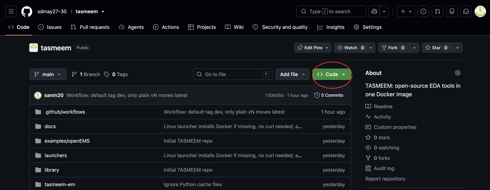
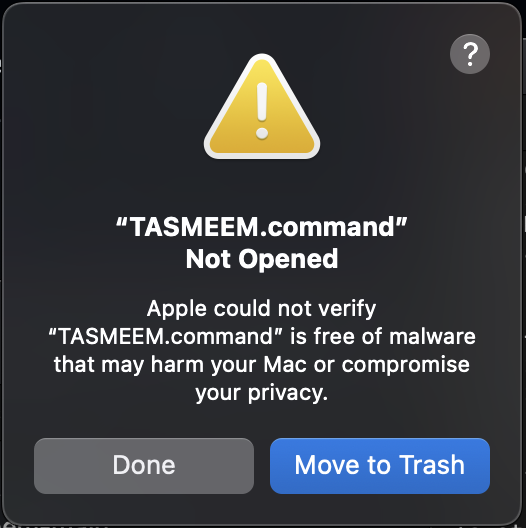
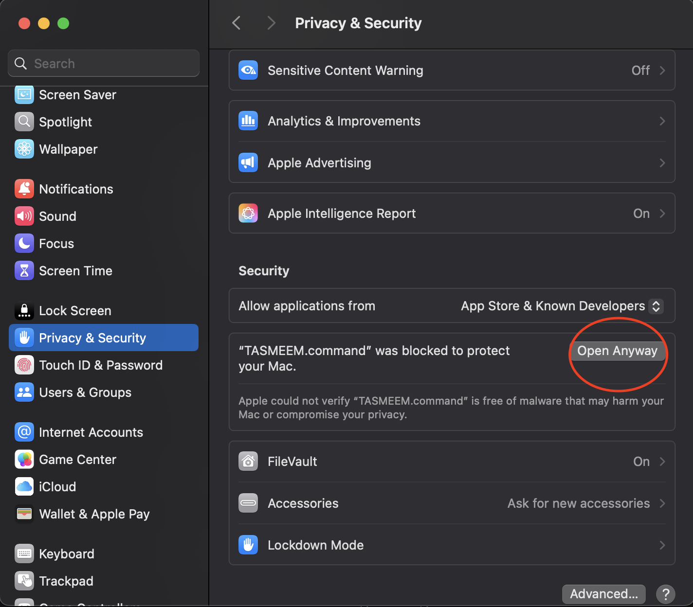
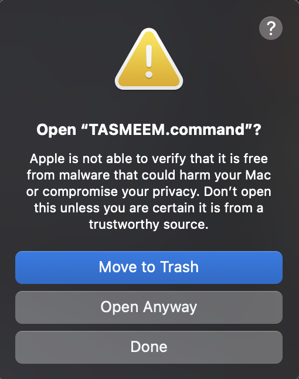
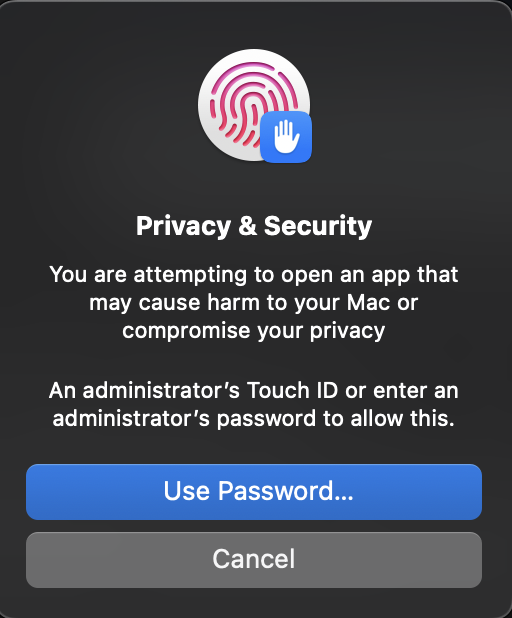
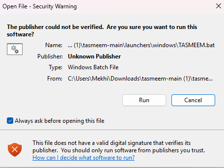
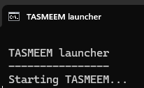

# TASMEEM User Manual (draft)

TASMEEM puts open-source electronics design and simulation tools (Qucs-S, openEMS, RF Layout, Octave and the TASMEEM EM Simulator) on one desktop that opens in your web browser. You install one program (Docker), download this project, and double-click a launcher.

## Before you start

| | |
|---|---|
| Computer | Mac, Windows 10 or 11, or Linux. Intel, AMD and Apple Silicon chips all work. |
| Free disk space | About 10 GB for the download. About 30 GB if the image has to be built on your computer instead. |
| Memory | 8 GB recommended, 4 GB minimum. |
| Internet | Needed for the first start (about 1.3 GB download). |

The first start downloads the TASMEEM image. After that it starts in seconds.

---

## Mac

### 1. Install Docker Desktop
1. Open https://www.docker.com/products/docker-desktop/ and download the Mac version.
   - Apple menu > About This Mac shows your chip. Choose **Apple Silicon** for M1 or newer, **Intel** otherwise.
2. Open the downloaded file and drag Docker to Applications.
3. Open Docker Desktop once and accept the terms. You can skip signing in. Wait until it says Docker is running.

### 2. Download TASMEEM
1. On the project page, click **Code > Download ZIP**.

   

2. Double-click the zip in Downloads to unzip it.

### 3. Start TASMEEM
1. Open the unzipped folder, then `launchers`, then `mac`.
2. Double-click **TASMEEM.command**.
3. The first time, macOS says it cannot verify the file. This is normal for files downloaded from the internet. Click **Done**. Do not click Move to Trash.

   

   Open **System Settings > Privacy & Security**, scroll down to Security, and click **Open Anyway** next to TASMEEM.command.

   

   A second box asks "Open TASMEEM.command?". Click **Open Anyway** again.

   

   Use Touch ID, or click **Use Password** and type the Mac password.

   

   This only happens the first time.
4. A window shows "Downloading TASMEEM". When it finishes, TASMEEM opens in your browser.

---

## Windows

### 1. Install Docker Desktop
1. Open https://www.docker.com/products/docker-desktop/ and download the Windows version.
2. Run the installer. Keep the default options (use WSL 2). Restart the computer if it asks.
3. Open Docker Desktop once and accept the terms. You can skip signing in. Wait until it says Docker is running.
4. If Docker asks for permission to use the network, click **Allow**.

### 2. Download TASMEEM
1. On the project page, click **Code > Download ZIP**.
2. Right-click the zip and choose **Extract All**. Do not run files from inside the zip.

### 3. Start TASMEEM
1. Open the extracted folder, then `launchers`, then `windows`.
2. Double-click **TASMEEM.bat**.
3. The first time, Windows shows a security warning that the publisher could not be verified. This is normal for files downloaded from the internet. Click **Run**.

   

   If a blue "Windows protected your PC" box appears instead, click **More info**, then **Run anyway**.
4. A black window opens and shows "Starting TASMEEM...". Leave it open. The first start downloads the tools (about 1.3 GB), then TASMEEM opens in your browser.

   

If Docker does not start, open PowerShell, type `wsl --update`, press Enter, then try again.

---

## Linux

### 1. Download TASMEEM
Open https://github.com/sdmay27-30/tasmeem in your browser, click **Code > Download ZIP**, then extract the zip (right-click, **Extract Here**).

### 2. Start TASMEEM
Open the extracted folder, then `launchers`, then `linux`. Right-click **tasmeem.sh** and choose **Run as Program** (the wording depends on your file manager). A window opens that shows the progress.

If your file manager does not offer that, right-click an empty spot in the extracted folder, choose **Open in Terminal**, and run:

```
bash launchers/linux/tasmeem.sh
```

If Docker is not installed, the launcher offers to install it (Ubuntu and Debian). Type **y**, enter your password when asked, and wait a few minutes. No logging out is needed. When the download finishes, your browser opens TASMEEM. If it does not, open
`http://localhost:6080/vnc.html?autoconnect=true&password=tasmeem&resize=scale` yourself.

Other Linux systems: install Docker from https://docs.docker.com/engine/install/ first, add yourself to the docker group (`sudo usermod -aG docker $USER`), log out and back in, then run the launcher.

---

## Using TASMEEM

TASMEEM opens as a desktop inside your browser tab. The icons are:

- **Qucs-S**: draw and simulate circuits.
- **openEMS (Octave)**: run openEMS scripts.
- **TASMEEM EM Simulator**: draw an antenna from shapes and simulate it with no scripts.
- **AppCSXCAD**: view a 3D model.

Guides for each tool:

- [Qucs-S](tools/qucs-s.md): draw and simulate circuits.
- [RF Layout](tools/rf-layout.md): turn a microstrip schematic into a board layout and an openEMS simulation.

**Save your files in the `work` folder.** It is the `work` folder next to the launchers on your computer, so files stay after TASMEEM stops. Anything saved elsewhere is removed when TASMEEM stops.

## Stopping TASMEEM

Either of these works:
- Close the TASMEEM browser tab. TASMEEM stops about 2 minutes later.
- Press any key in the launcher window (Windows: press **S**).
- Stop the TASMEEM container in Docker Desktop. This stops it right away.

Closing the launcher window by itself does not stop TASMEEM. It stops when its browser tab is closed.

## Starting again

Double-click the same launcher. It starts in seconds because the image is already on your computer.

## Updating

Download the new ZIP from the project page and use its launcher. The launcher names the version it needs, and downloads it if your computer does not have it yet. (This section will change when the update flow is finalized.)

## Fixing problems

| What you see | What to do |
|---|---|
| Docker is not installed | Install Docker Desktop (see your system above), open it once, then start the launcher again. |
| Docker is not running | Open Docker Desktop and wait until it says it is running, then start the launcher again. |
| Windows: Docker will not start | Open PowerShell, run `wsl --update`, and try again. |
| "Port 6080 in use" | Close other TASMEEM windows or restart Docker, then try again. |
| Linux: "permission denied" for Docker | Run the launcher again (it uses administrator access), or run `sudo usermod -aG docker $USER` and log out and back in. |
| Download or build fails, or disk full | Free up at least 10 GB (30 GB to build) and start again. |
| Browser did not open | Go to `http://localhost:6080/vnc.html?autoconnect=true&password=tasmeem&resize=scale`. |

## Status

Draft. Tested so far with the v6 image: Mac (Apple Silicon), Windows 10/11 (Intel/AMD), and Linux (Ubuntu on ARM64 and x86_64), including starting, all four apps, saving to the `work` folder, and both ways of stopping. On a Windows PC with Docker Desktop installed, going from the download page to a running TASMEEM took about 2 minutes. Intel Macs and Linux systems other than Ubuntu and Debian have not been tested.
