# Qucs-S: draw and simulate circuits

> **Draft note:** steps marked with a comment need a check against the running image and a screenshot before this page is final.

Qucs-S is the circuit simulator in TASMEEM. You draw a schematic, add a simulation, run it and look at the plots. It does not simulate by itself. It sends your circuit to a simulator engine and shows the results.

## What is installed

| Engine | Use it for |
|---|---|
| **ngspice** | General circuits (resistors, capacitors, op amps, transistors) and SPICE models |
| **Qucsator-RF** | RF and microwave work: S-parameters and microstrip lines |

Both are already installed in TASMEEM. Nothing to download.

## Open it

Double-click the **Qucs-S** icon on the TASMEEM desktop.

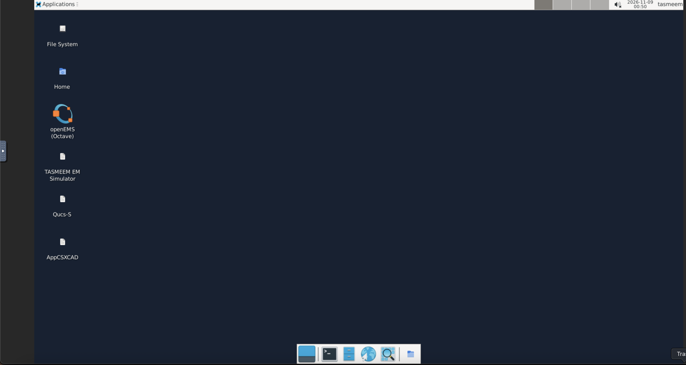
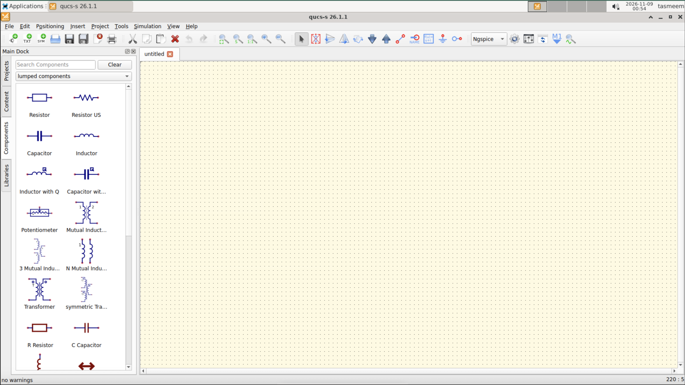

The first time Qucs-S starts, a box says where the simulators were found (ngspice and QucsatorRF). Both are already installed. Click **OK**.

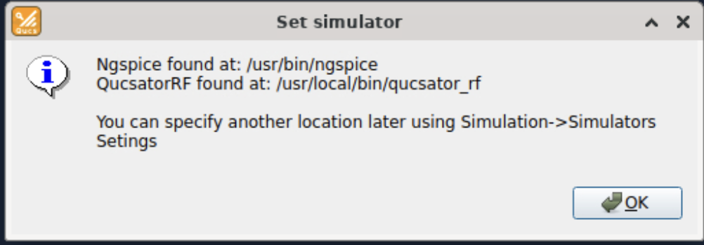

## Draw and simulate a circuit

1. **Place parts.** Pick parts from the component list on the left (resistors, capacitors, inductors, sources, ground) and click on the schematic to drop them.
2. **Wire them.** Use the wire tool to connect the parts. Every circuit needs a ground.
3. **Add a simulation.** Pick the simulation type you need from the simulations list and place it on the schematic. For an AC sweep use the AC simulation. For RF work use the **S-Parameter Simulation**, which sets the start and stop frequency.
4. **For S-parameters, add ports.** Place a **Power Source** on the input node and another on the output node. These act as the test ports (port 1 and port 2).
5. **Choose the engine.** Use the simulator dropdown in the toolbar (it shows Ngspice by default). Use ngspice for general circuits and Qucsator-RF for RF and microstrip. Choose it before picking parts, because the part list changes with the engine. **Simulation > Select default simulator** sets the default.
6. **Run it.** Choose **Simulation > Simulate** or press **F2**. A window shows the simulator messages. With ngspice, click **Exit** when it finishes. With Qucsator-RF the window is called Qucs Simulation Messages. When it says "Ready" and the Errors and Warnings box is empty, click **Goto display page** to see the results.

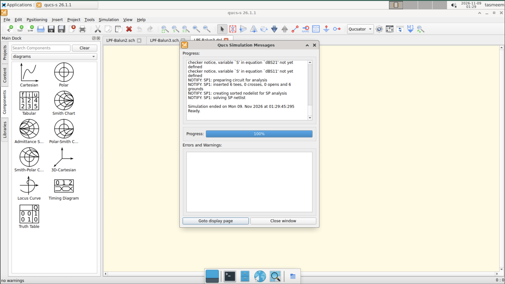

7. **Plot the results.** The display page may be blank. Add a diagram yourself:
   - In the components panel, open the dropdown and choose **diagrams**. Click **Cartesian** (or **Smith Chart** for RF), then click the display page to place it.
   - Double-click the diagram. In the list of data, double-click what you want to plot. Scroll down the list: equations in the schematic, such as `dBS21` and `dBS11`, appear below the raw values. Click **OK**.

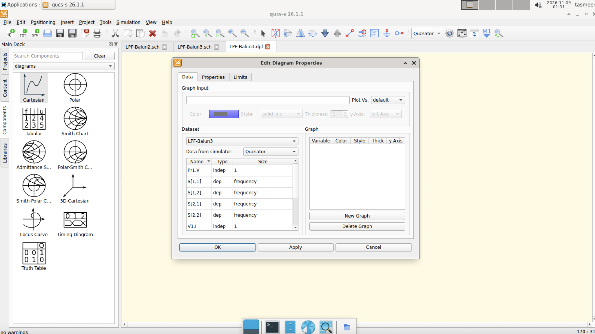

The result is the filter's response: S21 (green) shows the passband and where it drops off, and S11 (magenta) shows the match.

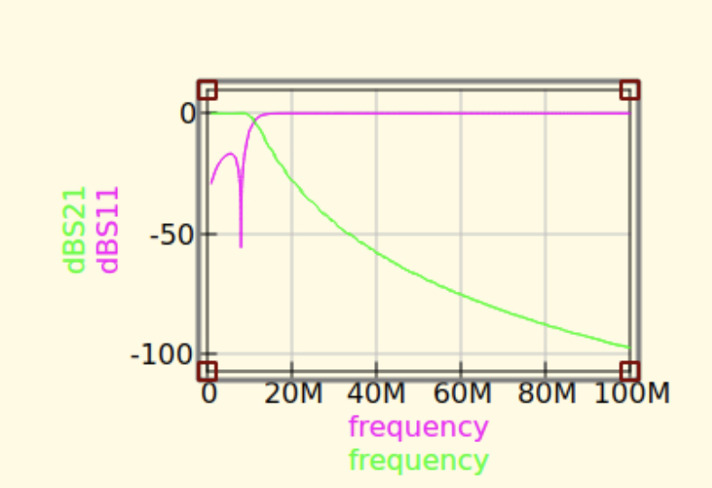

If an equation such as `dBS21=dB(S[2,1])` is missing, add an **Equation** block from the **simulations** list, type it in, simulate again, and it will then appear in the data list. Typing `dB(...)` straight into the Graph Input box does not work.

<!-- Source: Qucs-S quick reference. Simulate is Simulation > Simulate or F2. Engine: toolbar dropdown or Simulation > Select default simulator. -->

For a microstrip circuit, the schematic also needs a **Substrate** component, as in this low-pass filter:

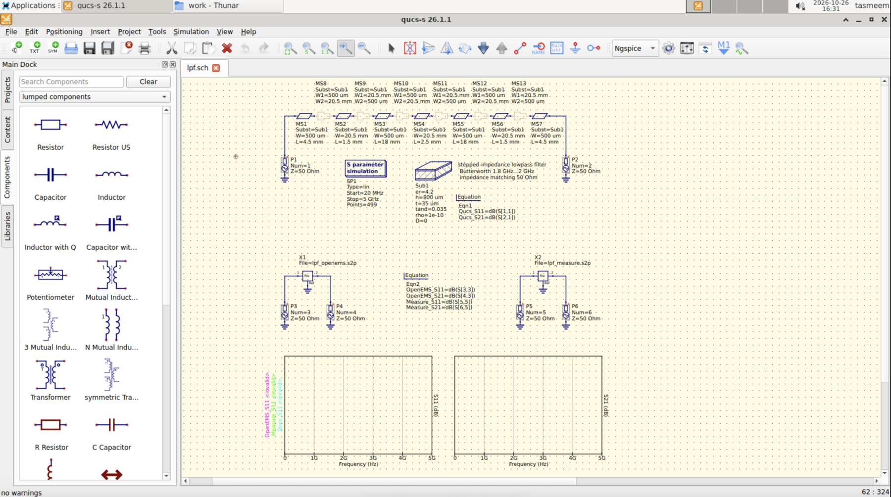

### Naming S-parameters in a plot

| Engine | S21 looks like | S11 looks like |
|---|---|---|
| Qucsator-RF | `S[2,1]` | `S[1,1]` |
| ngspice | `v(s_2_1)` | `v(s_1_1)` |

ngspice needs version 37 or newer for S-parameters. The version in TASMEEM is new enough.

## Microstrip lines (RF boards)

Microstrip parts need a **Substrate** component on the schematic. Each line has a **Substr** setting that names it (for example `Substr1`). Set the substrate's board height, relative permittivity (about 4.3 for FR-4) and copper thickness. If a line is missing its substrate, the simulation shows an error.

To turn a microstrip schematic into a board layout, see [RF Layout](rf-layout.md).

## Save your work

Save schematics in the **work** folder. It is the `work` folder next to the launcher on your computer, so your files are still there after TASMEEM stops. Files saved anywhere else are removed when TASMEEM stops.

In the Open and Save dialogs, Qucs-S starts in your home folder. Double-click **work** to open the folder that is kept between sessions.

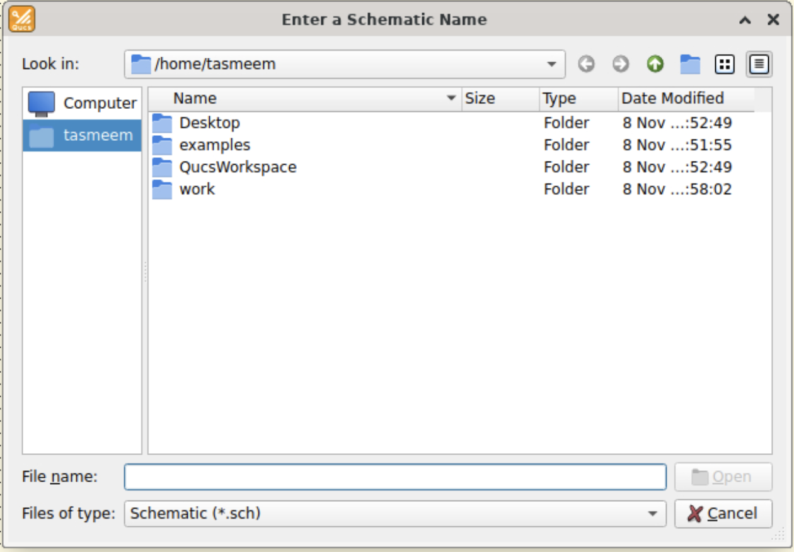

## Examples

Qucs-S comes with its own example schematics. Open them from **File > Examples** (Ctrl+Alt+E).

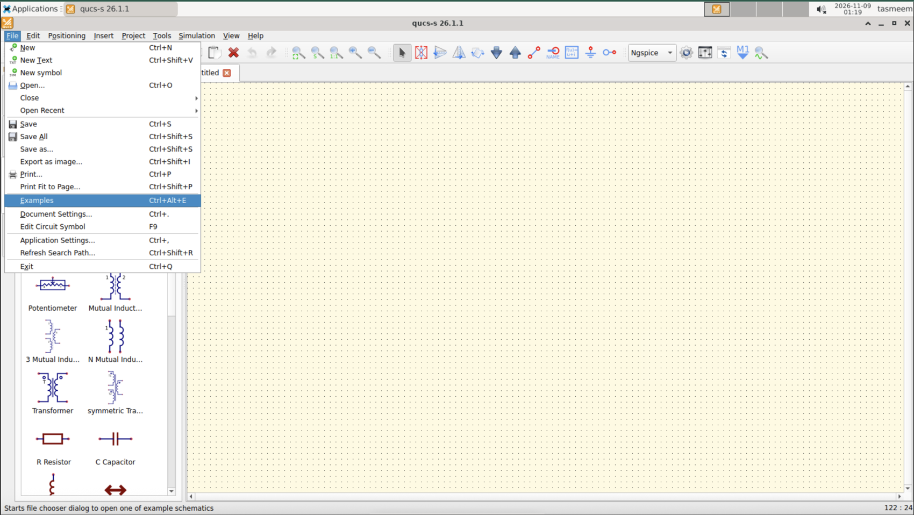

A file chooser opens in the examples folder, which has these folders:

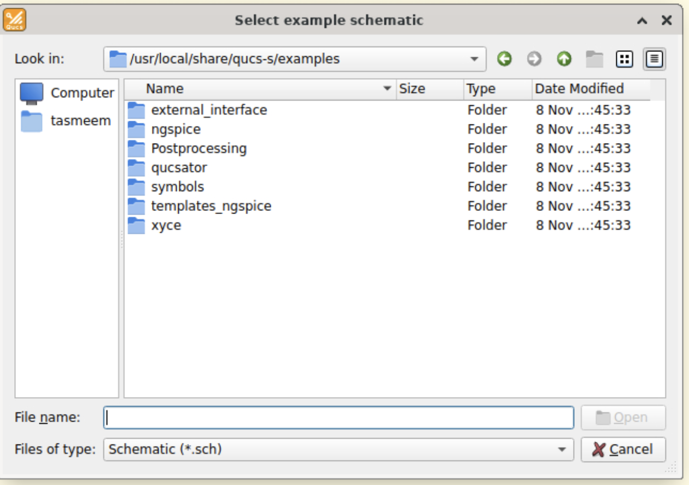

- **ngspice:** examples for the ngspice engine, sorted into topic folders.
- **qucsator:** examples for the Qucsator-RF engine, in four topic folders.
- **Postprocessing:** examples of plotting and processing results.
- **external_interface, symbols, templates_ngspice, xyce:** examples for connecting outside tools, custom symbols, ngspice templates and the Xyce engine (Xyce is not installed in TASMEEM).

The **ngspice** folder has these topics: B-Sources, Devices, Digital, General Electronics, MagneticCores, Miscellaneous, NGspice features, OpenVAF, Power Electronics, RF and XSPICE_CM.

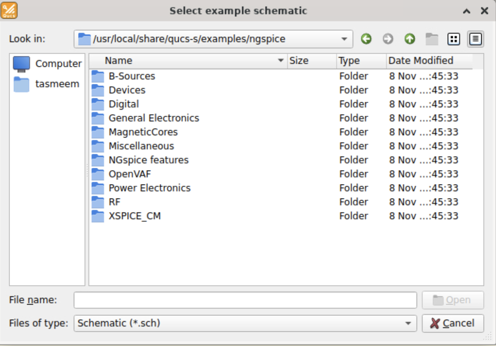

The **qucsator** folder has four: Devices, General Electronics, Power Electronics and **RF**.

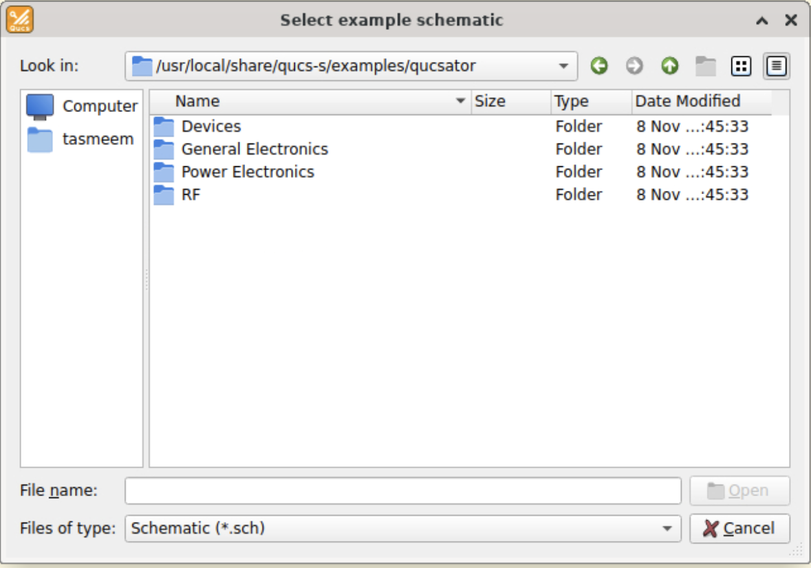

The examples are read-only, so they cannot be simulated where they are. When you open one, Qucs-S shows this message:

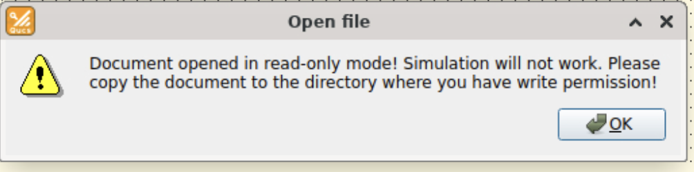

Click **OK**, then use **File > Save as** to save a copy in the **work** folder.

Before simulating, set the engine in the toolbar dropdown to match the example's folder: **Ngspice** for examples from the `ngspice` folder, and **Qucsator-RF** for examples from the `qucsator` folder. Then run the copy with **Simulation > Simulate** (F2). The original stays untouched.

An example from the `qucsator` folder run with Ngspice fails with an error like "Expression err: db(s[1,1])" and "There were simulation errors":

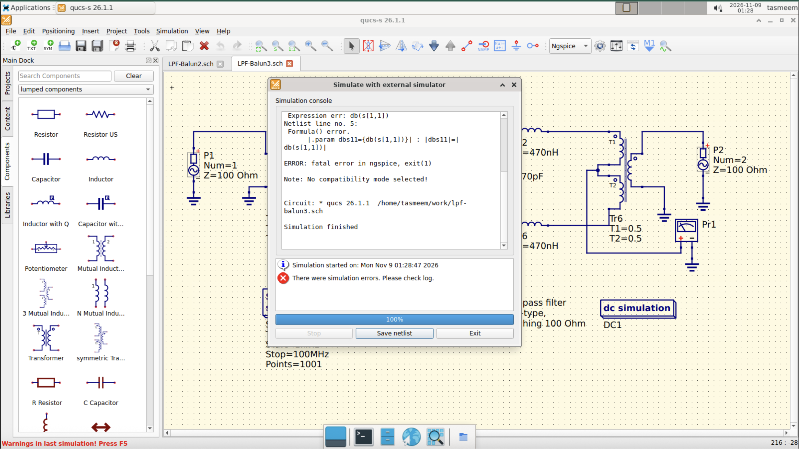

The fix is to switch the dropdown to **Qucsator-RF** and simulate again. A successful run ends with "Ready" and an empty Errors and Warnings box.

For RF practice, open **qucsator > RF**. It is sorted into Amplifiers, Couplers, Filters, Frequency Multipliers, Miscellaneous, Mixers, Oscillators, Power combiners, Power Detectors and Transmission Lines.

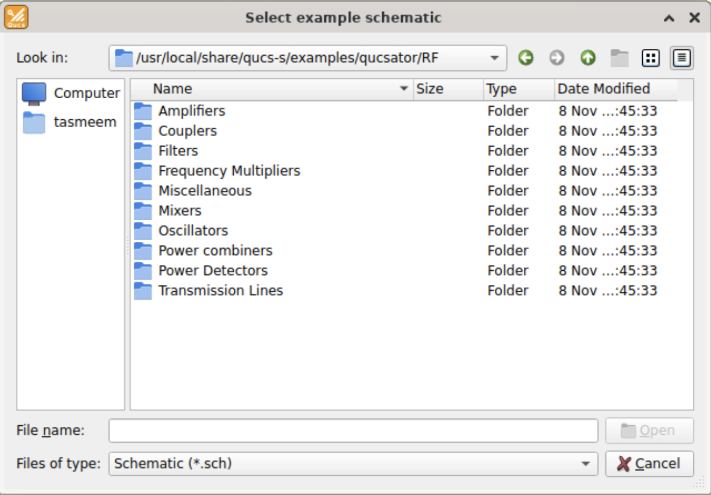

Start with the **Filters** folder. Open a filter, save a copy in **work**, run it with F2, and compare its S21 plot to what you expect. The **Transmission Lines** folder is a good next step before building a microstrip board. TASMEEM also loads a shared parts library.

## If something goes wrong

| What you see | What to try |
|---|---|
| "Document opened in read-only mode! Simulation will not work" | Click OK, then **File > Save as** and save a copy in the **work** folder. Simulate the copy |
| "Expression err: db(s[1,1])" and "There were simulation errors" | The example was made for the other engine. Switch the toolbar dropdown to **Qucsator-RF** (for RF examples) and press F2 again |
| A simulation says a part has no model | Pick a part from the library that has a SPICE model, or change the engine |
| The plot is a single dot or a flat line | Check the sweep settings and the unit letters (write 100 kHz with a lowercase `k`) |
| A microstrip line gives an error | Add a Substrate component and set the line's Substr name to match |
| The window is too small | Resize the browser window. TASMEEM scales to fit |

## More help

The official Qucs-S help and tutorials: https://qucs-s-help.readthedocs.io/
