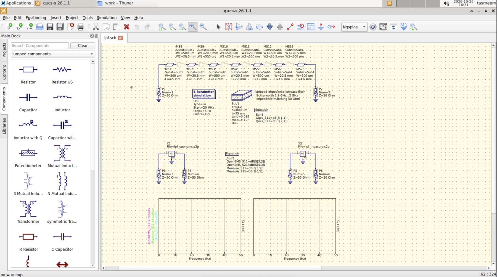
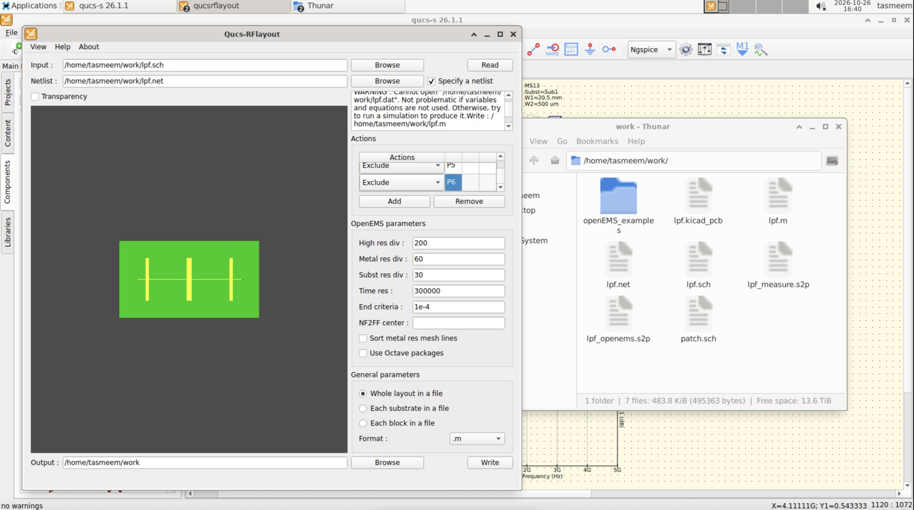
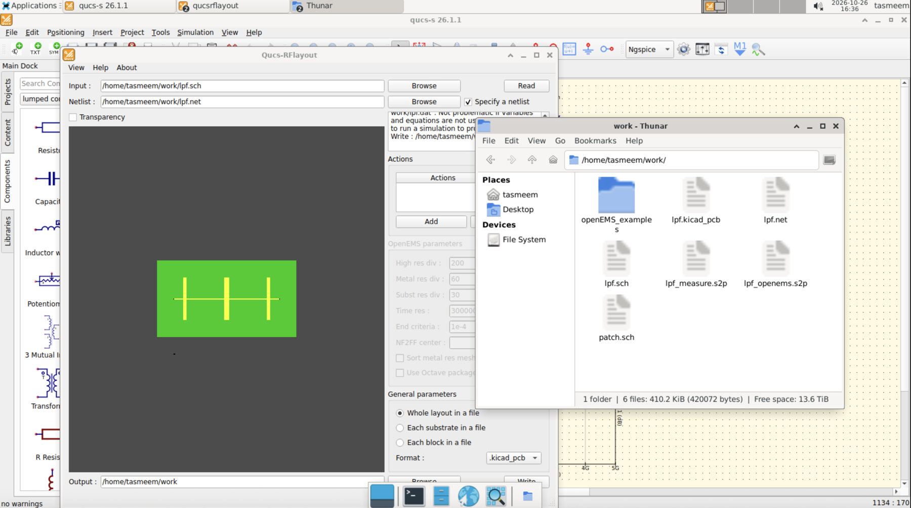
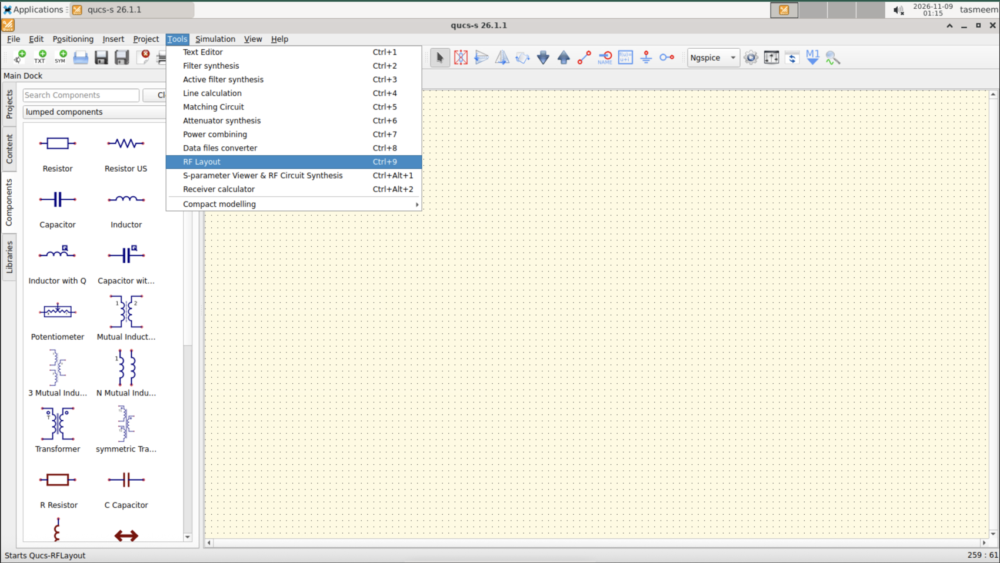
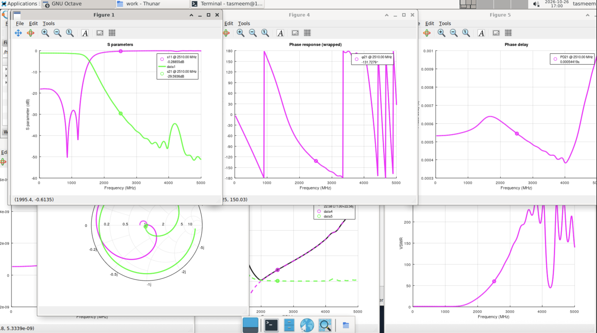
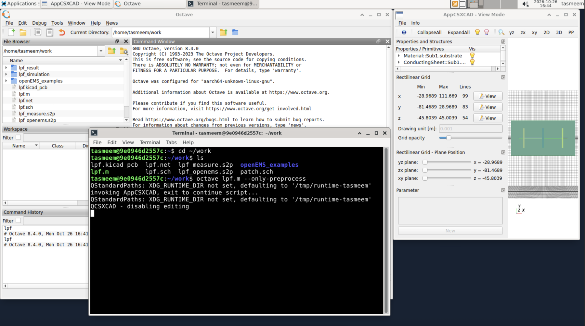
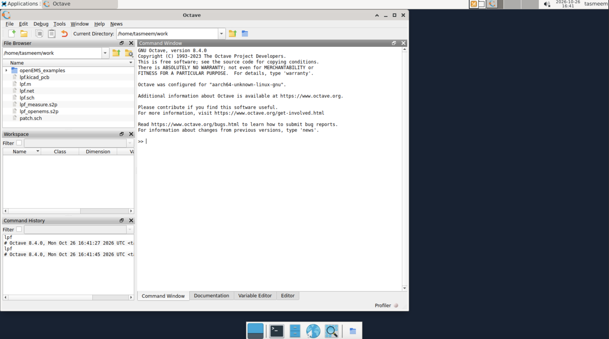

# RF Layout: turn a microstrip schematic into a board

> **Draft note:** screenshots come from the Oct 26 test run. Check the steps once against the latest image.

Qucs-RFlayout takes a microstrip schematic from Qucs-S and exports it two ways:

- A **KiCad layout** for the circuit board.
- An **openEMS script** (a `.m` file) that simulates the board's electromagnetic behavior.

It works with **microstrip circuits only**. Coplanar waveguide is not supported yet, and parts that are not microstrip cannot be turned into copper shapes. The idea is to design and check a circuit in Qucs-S, then see what the real copper and board material do to it.

## What you need first

1. A microstrip schematic in Qucs-S: microstrip lines and bends, a **Substrate** component, and two ports. A wire can only join two component ports, so use the dedicated **tee** and **cross** microstrip parts for junctions.
2. The circuit simulated in Qucs-S first, so you know what the answer should look like (see [Qucs-S](qucs-s.md)).
3. The schematic saved in the **work** folder.



## Steps

1. Open the schematic in Qucs-S and run the simulation to confirm it works.
2. In Qucs-S, open **Tools** and choose **RF Layout**. This is already set up in TASMEEM.
3. Choose what to export: the KiCad layout, the openEMS script, or both.
4. Save the output into the **work** folder.

The **Qucs-RFlayout** window opens with the schematic loaded.



- **Input** is the schematic and **Netlist** is its netlist. Click **Read** to load them. The green board preview shows the copper.
- **Actions** lets you exclude ports that are not part of the board (for example the extra ports used for comparison data).
- **Format** chooses what to write: `.m` for the openEMS script, or `.kicad_pcb` for the KiCad layout. Other formats in the list are a KiCad footprint (`.kicad_mod`), a pcb-rnd layout (`.lht`) and an SVG image (SVG is marked beta by the tool's authors).
- **Output** is the folder to write to. Leave it as `/home/tasmeem/work`, then click **Write**.

Write once for each format. The files appear in the work folder, named after the schematic. For `lpf.sch` they are `lpf.m` and `lpf.kicad_pcb`.



To open it, use **Tools > RF Layout** in Qucs-S (shortcut Ctrl+9).



## Look at the board in KiCad

Open the exported layout file in KiCad to see the copper shapes and board outline.

KiCad is not in the TASMEEM image yet. Until it is, copy the `.kicad_pcb` file out of the work folder and open it in KiCad on your own computer.

## Run the electromagnetic simulation

1. Open the terminal from the panel at the bottom of the TASMEEM desktop (the black icon).
2. Type `cd ~/work` and press Enter. This is where the exported script is.
3. Type `octave lpf.m` and press Enter. Replace `lpf` with your schematic name. Running it from the terminal also avoids the Octave window closing when a script name is typed.
4. When it finishes, plots appear: S-parameters, phase, Smith chart, VSWR and more.



To look at the 3D structure first, type `octave lpf.m --only-preprocess`. This opens **AppCSXCAD** with the board geometry and does not run the simulation.



The **openEMS (Octave)** icon on the desktop opens the Octave window, which is useful for browsing the work folder.



## Compare with Qucs-S

Put the S21 plot from Qucs-S next to the openEMS S21 plot. They should have the same overall shape. Small differences are normal, because openEMS includes things Qucs-S does not, such as the exact shapes of corners and gaps.

## If something goes wrong

During the team's testing of a low-pass filter, three things needed attention. Check them first if a run fails:

- **S-parameter files missing:** the schematic points to S-parameter files (such as `lpf_openems.s2p` and `lpf_measure.s2p`). Copy them into the same folder as the schematic. The window may also warn that it cannot open `lpf.dat`. This is harmless unless the schematic uses equations. If it does, run the Qucs-S simulation first so the file is created.
- **No substrate found:** the export can fail with "No substrate used in a block" when the schematic holds extra parts that are not microstrip, such as ports used only for comparison data. In **Actions**, choose **Exclude** and add those ports (for example P3 to P6), then click **Write** again. Every microstrip line must name its Substrate component.
- **Plots do not draw:** this used to be caused by a missing font. It is fixed in the TASMEEM image, so restart TASMEEM if you still see it.

If the Octave window closes when you type a script name, run the script from the terminal as above. This is a known issue being tracked.


## Command line

The same export can be run without the window. This is how scripts and the tool's own documentation use it:

```
qucsrflayout -i schematic.sch -o output-folder -f .kicad_pcb
```

`-i` is the input schematic, `-o` is the folder to write to, and `-f` is the format (`.m`, `.kicad_pcb`, and so on).

## Related tools

The TASMEEM EM Simulator can run similar simulations without scripts. A translator from RF Layout scripts to the EM Simulator is planned.

More detail is on the [Qucs-RFlayout project page](https://github.com/thomaslepoix/Qucs-RFlayout). It is open source (GPL-3.0).
